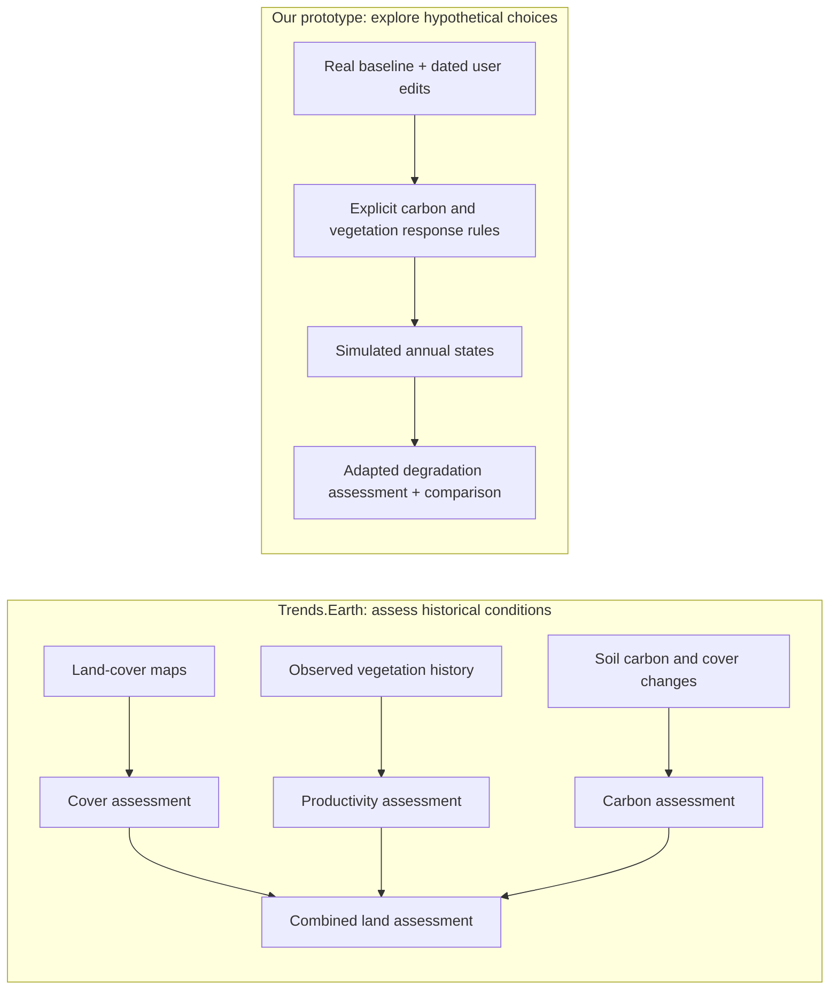

# Presentation brief and live-demo runbook

Audience: scientists, community practitioners, and people without GIS training. Working duration: **8 minutes**, including a **3-minute demo**. Adjust timing to the event slot.

The slides explain the broader problem and approach. **Amayaga appears on one context slide; its story unfolds during the demo.** This file is a content and design brief, not a finished deck.

## 1. Visual direction

Use the application's quiet, map-led visual style: warm paper, dark green typography, large numbers, generous space. Prefer actual app captures and simple scientific diagrams. Keep geographical context visible around the decision grid.

| Role | Color | Use |
|---|---|---|
| Background | `#F7F8F3` | Main slide canvas |
| Primary text | `#203D34` | Headlines, labels, numbers |
| Forest green | `#214F40` | Primary emphasis; selective-design line |
| Pale lime | `#DCE9AD` | Highlight panels with dark text |
| Terracotta | `#A45132` | Tradeoffs; expanded-design line |
| Slate blue | `#496D88` | Observations and data inputs |
| Purple | `#80608D` | Declining land, matching the map's meaning |
| Gray | `#D9DCD6` | Unknown or unavailable data |
| Divider | `#E0E6DD` | Rules and panel borders |

- **Canvas:** 16:9; approximately 6% outer margins. Use a 60/40 visual/text split or one full-width chart.
- **Typography:** Manrope for headings; DM Sans for body and numbers. Titles 36–44 pt, body 24–28 pt, key numbers 52–72 pt, source notes 14–16 pt. Use tabular numerals in tables.
- **Copy:** one claim per slide, a headline of at most 8 words, and roughly 25–40 body words. Explanations and caveats belong in speaker notes except the qualifier essential to interpreting a chart.
- **Hierarchy:** plain-language label first, technical term second: “Vegetation greenness · NDVI.” Define every acronym on first use.
- **Chart encoding:** label lines directly; distinguish reference with dots and designs with solid/dashed strokes. Color alone must not convey meaning. Keep app screenshots in their native palette; label them rather than silently recoloring them.
- **Axes:** show units and year. Use the same padded min/max scale for all compared designs. Label a cropped Y-axis clearly. Start area-comparison bars at zero. Do not imply larger apparent separation means larger real-world certainty.
- **Backgrounds:** title/closing slides can use dark green with paper-colored type. Content slides use paper. Put screenshots beside text, or under an opaque text panel; avoid text over a busy map.
- **Motion:** reveal the three model branches sequentially; animate only the simulation clock or selected change. No decorative spinning globes or continuous background animation.

## 2. Main slides

Suggested sequence: approximately 5 minutes of slides plus 3 minutes of live interaction. The quoted copy below is proposed presentation wording, not a quotation from an external source.

### Slide 1 — Hello / introduction · 15 seconds

**Headline:** “Explore land choices. Shape shared futures.”

**On slide:**

> Community Land Planning  
> An interactive landscape sandbox  
> [Names] · [One relevant background per presenter]

**Visual:** a cropped application map with one highlighted intervention, on a dark-green title canvas. Use the actual project name consistently when finalized; the current app still displays “phone na hello” in some places.

**Speaker point:** participants can propose a land-use change, inspect modeled consequences, and discuss alternatives. Add real team backgrounds; none are assumed here.

### Slide 2 — Motivation · 30 seconds

**Headline:** “People need a voice in land decisions.”

**On slide:**

> Restore land. Understand tradeoffs. Participate.  
> **SDG 15.3:** land restoration  
> **SDG 11.3:** participatory planning  
> Designed for young people aged **15–24**.

**Visual:** two small SDG references beside a community → proposal → discussion loop. Keep the human decision more prominent than the goal icons.

**Speaker point:** the hackathon asks for accessible learning that supports participation. Success means someone can explain a consequence and a tradeoff. We have not yet measured learning gains or behavior change.

**Sources:** [UN Goal 15, target 15.3](https://sdgs.un.org/goals/goal15); [UN Goal 11, target 11.3](https://sdgs.un.org/goals/goal11). The 15–24 audience comes from the supplied hackathon brief.

### Slide 3 — Background / existing approaches · 40 seconds

**Headline:** “A land choice has several consequences.”

**On slide:**

> **Land cover:** what occupies the ground  
> **Productivity:** how vegetation performs  
> **Soil carbon:** carbon stored below ground

**Visual:** three illustrated tiles: a land-cover grid, a vegetation time series, and a soil cross-section. Below them, a compact comparison:

| Approach | Main contribution |
|---|---|
| Block by Block | Community expression through public-space design |
| Trends.Earth | Spatial assessment of land degradation |
| Our prototype | Interactive choices and explainable scenario comparisons |

**Speaker point:** degradation can affect farmers, households, and people depending on shared land and resources. A greener-looking map does not establish that all environmental or social outcomes improved. Block by Block already supports community participation; our contribution is an educational scenario workflow, not the invention of participatory planning.

**Sources:** [Block by Block methodology](https://www.blockbyblock.org/approach); [Trends.Earth assessment methods](https://docs.trends.earth/en/latest/for_users/features/unccdreporting.html).

### Slide 4 — Challenges / scientific translation · 45 seconds

**Headline:** “Real data needs explicit assumptions.”

**On slide:**

> **3 core inputs → 165 m decision cells**  
> Preserve missing values. Explain modeled responses.  
> People set priorities; agents help explore them.

**Visual:** redraw the two pipelines below. Use blue for observed inputs, terracotta for scenario assumptions, and green for evaluated outcomes. Keep them distinct.

**Speaker point:** real observations establish the starting state; they do not automatically predict the result of an intervention. Missing measurements remain unknown. Community values, ownership, and acceptable tradeoffs cannot be inferred from the satellite map.

**Figure reference:** [Trends.Earth's three-indicator graphic](https://docs.trends.earth/en/latest/_images/indicator_15_3_1.png). A redrawn, attributed diagram is easier to read on stage. The prototype branch must be labeled as our adaptation.

### Slide 5 — Demo context · 20 seconds

**Headline:** “A real setting. Hypothetical proposals.”

**On slide:**

> **Muyira, Rwanda**  
> Inspired by UNDP-supported Green Amayaga  
> **1,597 ha · 625 cells · 2021 baseline**  
> How much land should become forest?

**Visual:** Rwanda locator → study rectangle → app screenshot. Label the rectangle “illustrative study area”; it is not an official project boundary.

**Speaker point:** Green Amayaga was designed by UNDP with Rwanda's environment authority and GEF support. Its real activities include landscape restoration and support for livelihoods. Our proposals are independent educational scenarios, not the project's implemented plan or a UN-endorsed recommendation.

**Source:** [UNDP Green Amayaga project overview](https://www.undp.org/rwanda/news/green-amayaga-project-launch-forest-landscape-restoration-rwandas-amayaga-region).

**Switch to the live demo here.** Use the separate runbook below; do not distribute this case story across the other slides.

### Slide 6 — Under the hood · 45 seconds

**Headline:** “Traceable inputs. Reproducible scenarios.”

**On slide:**

> **10 m** land cover and vegetation inputs  
> **250 m** soil-carbon estimates  
> **165 m** decision grid  
> Baseline + dated edits + model version → result

**Visual:** three source grids feeding a common decision cell; then a short baseline → edit log → evaluation → comparison strip.

| Core input | What it contributes |
|---|---|
| ESA WorldCover | 2020 or 2021 physical land-cover classification |
| Sentinel-2 WorldCover composite | Observed annual-median vegetation index, NDVI |
| ISRIC SoilGrids 2.0 | Estimated soil organic carbon in the top 30 cm |

**Speaker point:** the app retrieves raster windows for a selected region, aggregates measurements, and preserves provenance and missing coverage. Deterministic backend evaluation reconstructs results from the saved baseline and edits. Agents use the same application operations as the interface.

**Correction to the initial outline:** say **three core raster inputs**, not “only two datasets.” Trends.Earth supplies assessment methods; OpenStreetMap supplies map context. The separate voxel experiment uses additional data and is not part of this modeling demo.

### Slide 7 — Simplifying assumptions · 45 seconds

**Headline:** “Useful comparisons, with clear limits.”

**On slide:**

> **20-year** soil-carbon transition  
> **10-year** assumed forest NDVI response  
> No water flow, erosion, yield, or land-tenure model  
> Scenario estimates—not validated forecasts

**Visual:** one carbon response line and one vegetation response line, with an observation marker at the start. Pair each line with its assumption label. Use the technical notes below for questions, not a wall of formulas on the slide.

**Speaker point:** soil-carbon coefficients follow a documented transition method. Vegetation response times are prototype assumptions, and some coefficients come from San Francisco associations or placeholders; transfer to Rwanda is unvalidated. A 165 m full cell represents about **2.72 ha**, so painting is a landscape substitution, not planting an individual tree. Neighboring cells do not exchange water or sediment.

### Slide 8 — Three-month roadmap / close · 40 seconds

**Headline:** “One community. One credible decision.”

**On slide:**

> **Month 1:** agree the question; review local evidence  
> **Month 2:** improve one consequential mechanism  
> **Month 3:** pilot, measure learning, revise

**Visual:** three milestones, each paired with a concrete deliverable.

| Period | Deliverable | Evidence of progress |
|---|---|---|
| Weeks 1–4 | One partner-reviewed scenario, local data inventory, agreed decision constraints | Community and domain reviewers can identify the assumptions and missing factors |
| Weeks 5–8 | Review carbon/NDVI parameters; prototype one erosion/sediment pathway if suitable local inputs exist | Document sensitivity, missing data, and comparison against independent evidence; omit the feature if evidence is inadequate |
| Weeks 9–12 | Facilitated youth pilot; clearer explanations and deployable workshop package | Pre/post questions about consequences, uncertainty, and tradeoffs; record whether people can explain and revise a proposal |

**Speaker point:** this is a proposed plan, not an existing partnership or delivery guarantee. Prioritize one usable pilot over adding every environmental process. Preserve the public-benefit, non-profit purpose of the challenge.

**Closing line:** “Help people make a proposal they can explain—and question.”

## 3. Separate live-demo runbook

### Story and audience choice

**Opening:** “A community wants to restore trees while retaining land for farming. Which proposal would you take into a community discussion?”

Introduce one invented workshop constraint: **retain at least 1,000 ha of cropland within this study area.** Clearly call this a demo constraint, not a local policy or resident preference.

The real project provides context, not proof of our predictions. UNDP describes a hillside farmer, Trifine, participating in tree planting, terraces, and trenches; our app does not model that entire intervention. [UNDP's farmer case study](https://www.undp.org/rwanda/blog/seeds-change-rwandan-womans-inspiring-transformation-through-green-amayaga-initiative)

| Time | Interaction | Learning to elicit |
|---|---|---|
| 0:00–0:30 | Open the unchanged reference; inspect a cell and its inputs | Observed vegetation, estimated soil carbon, and mapped cover describe different things |
| 0:30–1:10 | Show selective restoration; move through 2026, 2036, and 2046 | Land-cover editing is immediate; modeled carbon accumulation takes time |
| 1:10–1:50 | Compare selective and expanded proposals at 2046 using the same view and Y-axis | More modeled carbon gain can require more land conversion |
| 1:50–2:20 | Ask for a show of hands, then reveal cropland retained | Under the stated area constraint, selective restoration qualifies; expanded restoration does not |
| 2:20–2:45 | Ask the agent for a read-only explanation, or show a prepared response | The agent summarizes evidence; participants choose the tradeoff |
| 2:45–3:00 | Ask what information is missing before implementation | Tenure, food production, water, local priorities, and feasible restoration practices matter |

**Fun segment:** give participants the roles of farmer, young resident, or restoration planner. Ask each to name one condition they would add. Collect disagreement instead of announcing that a green map “wins.” Do not claim these role-play answers represent residents of Rwanda.

**Suggested agent prompt:** “Compare these two designs at 2046. Explain soil-carbon differences and missing factors in three short points. Do not edit any design or declare a winner.” The cropland-retention calculation below is prepared evidence; do not assume the current panel exposes it directly.

### Original demo results

These are the recorded outputs of the **original seeded designs**, evaluated at 2046, with interventions in 2026. Values are rounded for presentation.

| Proposal | Converted to trees | Cropland retained | Modeled soil-carbon change vs unchanged | Mean simulated NDVI |
|---|---:|---:|---:|---:|
| Unchanged | 0 ha | 1,154 ha | 0 t C | 0.526 |
| Selective | 109 ha | 1,056 ha | +5,326 t C | 0.534 |
| Expanded | 327 ha | 854 ha | +16,012 t C | 0.549 |

**On-stage quantitative takeaway:** the expanded proposal produces about **10,686 t C more modeled soil carbon**, while retaining about **202 ha less cropland** than the selective proposal. The model does not calculate lost food production or income. This is an area-versus-carbon comparison, not a benefit-cost analysis.

Use two aligned charts: cropland retained with a 1,000 ha constraint line, and modeled carbon change at 2046. Keep units separate. Label the carbon chart “Model output · assumed tropical-moist climate.” These totals are tonnes of **carbon**, not CO₂, and do not include tree biomass carbon.

### Reproducible setup and current-state warning

- Study rectangle, west/south/east/north: **29.8298, −2.3632, 29.8658, −2.3272**. Approximately 4 × 4 km around Muyira; not an official restoration boundary.
- Baseline: 2021; **625 cells**, approximately **1,596.6 ha**, 165 m grid. Source-valid cover, NDVI, and soil coverage are effectively 100% here; that is availability, not measurement accuracy.
- Hold the baseline unchanged until the hypothetical 2026 intervention. Compare at 2046. This does not reconstruct observed changes from 2021 to 2026.
- Use the same baseline, model versions, and assumed **tropical-moist** climate for every alternative.
- Original selection: full cells with at least 80% cropland and zero mapped built, water, or wetland fractions. Rank by distance to existing tree-dominated cells. Convert the nearest **40** or **120** cells to trees; the smaller set is contained in the larger set. Proximity is a transparent selection rule, not a modeled ecological benefit or proven optimal placement.
- Cropland retained is the sum of original cropland fractions × valid cell area for unconverted cells; converted cells become entirely tree cover. This explains why the conversion footprint and cropland loss differ.
- Versions: `soc-transition-history-v2`, `ndvi-scenario-linear-v0`. Local seed manifest: `game-folder/runtime/amayaga-demo.json`; original evaluation: `game-folder/runtime/amayaga-comparison.json`.

**Checked October 25, 2026:** the selective scene still matches the seeded intervention. The scene named “Expanded trees · 327 ha” has since been changed to grass, built, and bare-land edits; its title no longer describes its actions. The result table above must not be presented as that edited scene's current output. Before presenting, create a fresh expanded copy from the unchanged baseline using the original 120-cell selection, and verify the table again. Preserve the edited scene.

[Existing local comparison](http://127.0.0.1:8780/#compare/ec1c502e090a412cb1e677d2a4bf5349,a007b7ce21bb40a38badb3639f4fff2c?year=2046&layer=soc&field=design) — requires the local app and the workspace containing these scenes; update the link after recreating the presentation copy. These saved scenes are not bundled with a fresh repository clone.

## 4. Scientific notes for questions

### Carbon

For a single transition, the model uses `target = carbon_at_edit × transition_factor`, then moves linearly toward that target over 20 years. A later edit begins from the stock already attained. Climate is a selected assumption. With no subsequent intervention, stock plateaus after that transition period; running to 2132 does not create new ecological dynamics. Soil carbon is one property of soil, not a complete soil-health score.

### Vegetation

NDVI means **Normalized Difference Vegetation Index**, a satellite-derived indicator of vegetation greenness. Our target is the observed baseline plus a cover-dependent adjustment, clipped to −1…1. Tree response takes an assumed 10 years. Missing observed NDVI remains unknown. This does not estimate crop yield, biodiversity, seasonal growth, or a validated causal planting response. The model has no stochastic weather term.

### Degradation

The prototype adapts cover transitions, carbon assessment, and simulated productivity assessments. A known decline in one component can flag degradation. Productivity uses trajectory, state, and performance; complete productivity classification needs 13 annual samples. Missing components can leave land unassessed. This is not an official SDG 15.3.1 report, and the categories do not form a numeric severity scale.

### Comparison and uncertainty

Between-design mean and standard deviation describe the alternatives selected. They are **not prediction confidence intervals**. The unchanged reference is excluded from those statistics. Carbon totals, mean carbon density, greenness, and hectares classified as declining are separate quantities; never label the carbon graph “net land degradation.”

### What remains outside the model

No water routing, soil erosion, sediment transport, flood exposure, species diversity, food production, prices, land rights, displacement, or financial budgets. No physical interactions between adjacent cells. Whole-cell forest conversion does not represent agroforestry or terracing. Agents cannot supply the missing scientific mechanisms by writing a persuasive explanation.

## 5. Rehearsal assets and checks

- Capture the baseline, both intended proposals, and the comparison at **2046**. Keep a short recording as a fallback for network or agent latency.
- Recreate and verify the edited expanded proposal before capturing slides. Keep live experimentation in a separate copy.
- Refresh the app; wait for the timeline. Check shared min/max axes, units, active layer, and comparison year. Avoid letting playback run centuries beyond the intervention.
- Prepare the two area/carbon charts from the verified table. Retain “modeled” and the climate assumption on the carbon graphic.
- Prepare the single context map and a redrawn, attributed three-component pipeline. Attribute any external photograph and check its reuse terms; do not imply a pictured person used this app.
- Use a verified missing-data screenshot if discussing unknowns. Do not manufacture missing cells in the fully covered Amayaga example.
- Resolve presenter names/backgrounds and the project title before producing the deck. Do not use the unattributed community quotations in the old research notes.

Implementation detail and provenance: [current application notes](game-folder/README.md), [project direction](README.md), [scope comparison](scope-comparison.md). Archived design notes describe earlier intentions and are not evidence of current functionality.
