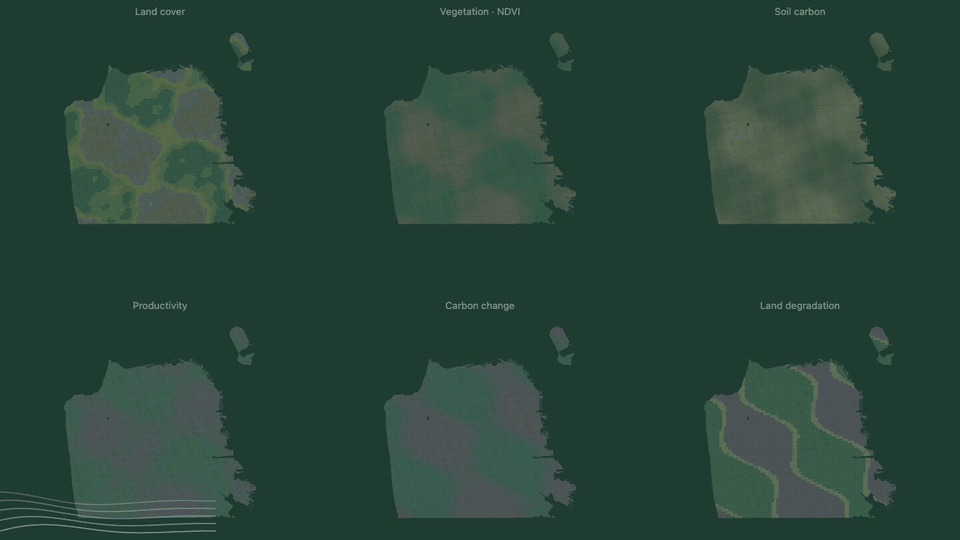
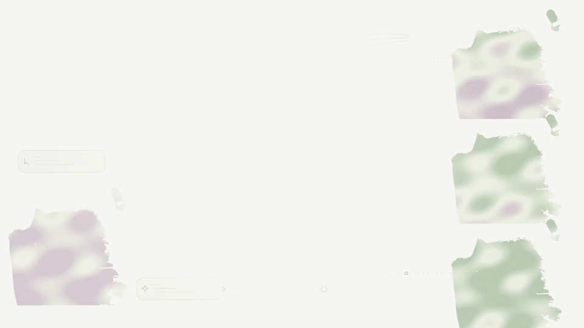
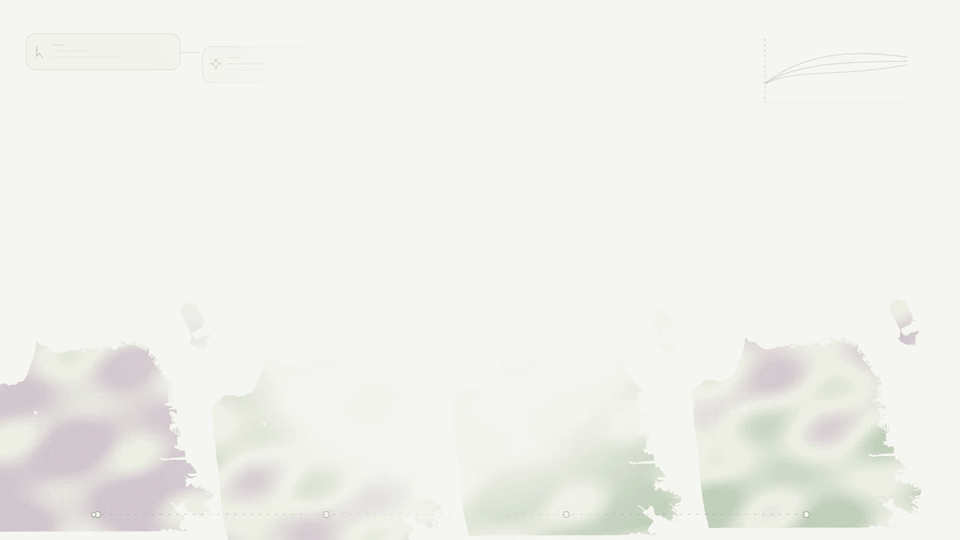
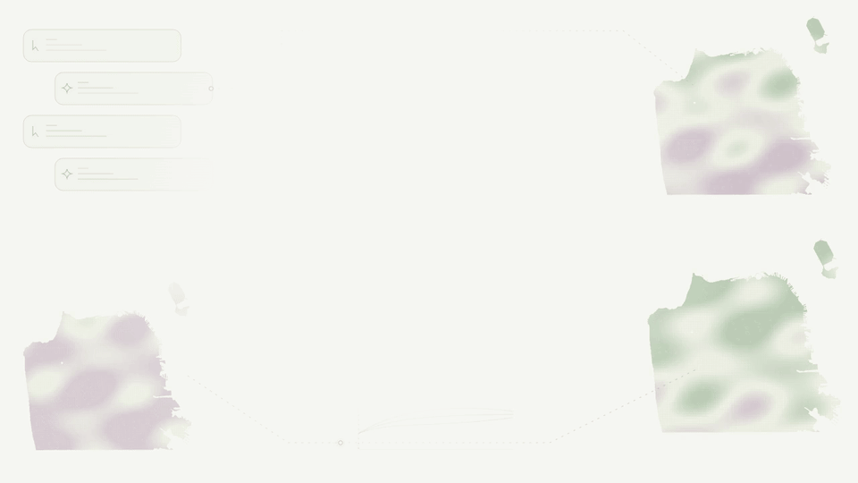

# planIt

---

# One place. Different possibilities.

A person proposes a change. The agent explores alternatives.

---

# See how choices change a landscape.

Explore gains, losses, and different paths through time.

---

# Propose. Explore. Reconsider together.

A shared planning conversation grounded in a place.
