<!-- _class: dark planit-opening -->
<!-- _paginate: false -->

<h1>planIt</h1>

<!-- Animated opening. Synthetic changing fields illustrate landscape possibilities; these are not model predictions. Advance to meet the presenters. -->

---

<!-- _class: dark names -->
<!-- _paginate: false -->

<h2>Richard Rex</h2>
ML &amp; Earth Science

Carbon sequestration Hydrogen storage

<h2>Kiran Kashyap</h2>
Business &amp; Communication

Consumer products Consulting VC

<!--
“I'm Richard. This is Kiran. We're building a way for young people to explore land-use decisions—and have something informed to say about them.” Richard: ML & Earth Science, carbon sequestration and hydrogen storage. Kiran: business and communication, consumer products. Backgrounds supplied by the presenters. 10 seconds.
-->

---

<!-- _class: mission -->

SDG 15 · LIFE ON LAND

“Protect, restore and promote sustainable use of terrestrial ecosystems, sustainably manage forests, combat desertification, and <em>halt and reverse land degradation</em> and halt biodiversity loss”

KEY INDICATOR · 15.3.1

“proportion of land that is degraded over total land area”

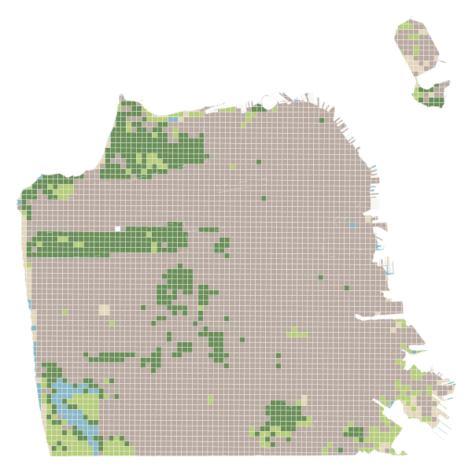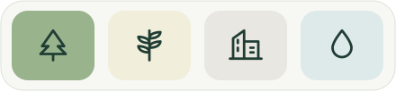

<!--
“The goal is restoration. This indicator asks how much land is degraded. Our part is helping people understand how their choices affect the land.” Ask aloud: “How do young people help shape that future?” The upper quote is the full Goal 15 wording as reproduced in the supplied Trends.Earth reference. The lower quote is the exact indicator 15.3.1 wording reproduced in Trends.Earth's documentation. Distinguish the ambition from its measurement; target 15.3 sets the restoration and land degradation neutrality objective. UNCCD is the custodian agency. Sources: https://sdgs.un.org/goals/goal15 and https://docs.trends.earth/en/latest/for_users/features/unccdreporting.html. The SF map illustrates the study area; it is land cover, not an indicator result. The following slides explain the measurements and combined assessment. The challenge audience is ages 15–24. Learning and participation outcomes have not yet been measured. 20 seconds.
-->

---

<!-- _class: foundations -->

Reading the land

# What are we measuring?

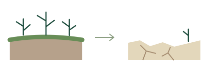
<h2>What is degradation?</h2>
A lasting loss of the land’s ability to support life and livelihoods.

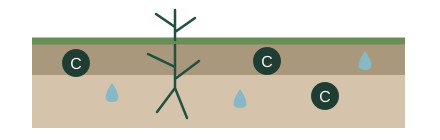
<h2>Why soil carbon?</h2>
Organic matter supports water and nutrient storage. Its carbon content helps indicate soil condition.

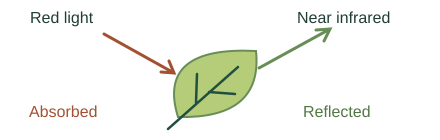
<h2>What does NDVI measure?</h2>
Vegetation greenness, measured from reflected light. A proxy for vegetation activity.

<!--
“Before combining maps, let's separate what each one tells us.” Degradation means a persistent reduction in land productivity, ecological condition or value to people. It is not simply brown land or a low NDVI pixel. Healthy drylands can have low greenness. The drawings on the left are conceptual illustrations, not observations or predicted outputs. Sources: UNCCD reporting glossary https://prais4-reporting-manual.unccd.int/en/2026/glossary.html and IPCC https://www.ipcc.ch/srccl/.
Soil organic carbon is the carbon in soil organic matter. Organic matter contributes to water storage, nutrient cycling and soil structure. SOC is one indicator, not a complete soil-health diagnosis. Our app models soil carbon, not tree biomass, and does not simulate water retention or nutrient cycling. FAO: https://www.fao.org/global-soil-partnership/programmes/recsoil/soil-organic-carbon/en.
NDVI means Normalized Difference Vegetation Index: (near-infrared minus red reflectance) / (near-infrared plus red reflectance). Green leaves absorb much red light and reflect strongly in the near infrared. NDVI is dimensionless, bounded from -1 to 1, affected by vegetation amount, seasonality, soils and observation conditions. It does not directly measure crop yield, biodiversity or soil carbon. Time-series analysis provides productivity signals; a single low value does not establish degradation. NASA: https://science.nasa.gov/earth/earth-observatory/global-vegetation-8622/; USGS: https://www.usgs.gov/landsat-missions/landsat-normalized-difference-vegetation-index. 40 seconds.
-->

---

<!-- _class: assessment -->

SDG 15.3.1 · LAND DEGRADATION

# Signals of land degradation

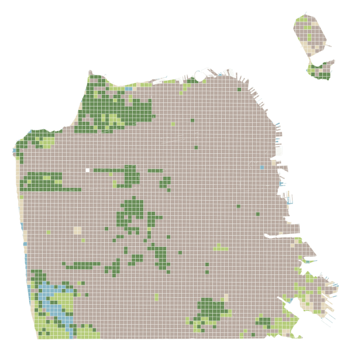
<h2>Land cover</h2>
Compare land-cover classes

<i style="background:#688d57"></i><i style="background:#b5cc79"></i><i style="background:#dbc889"></i><i style="background:#86b7a3"></i><i style="background:#b9aaa1"></i><i style="background:#e3d7bb"></i><i style="background:#88b7c7"></i>

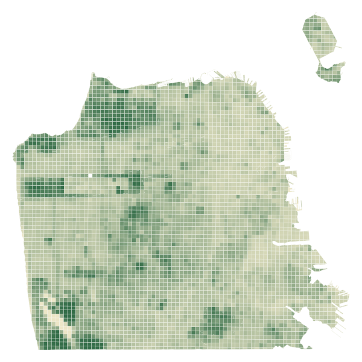
<h2>Vegetation index</h2>
NDVI over time → productivity

≤ −0.1≥ 0.8

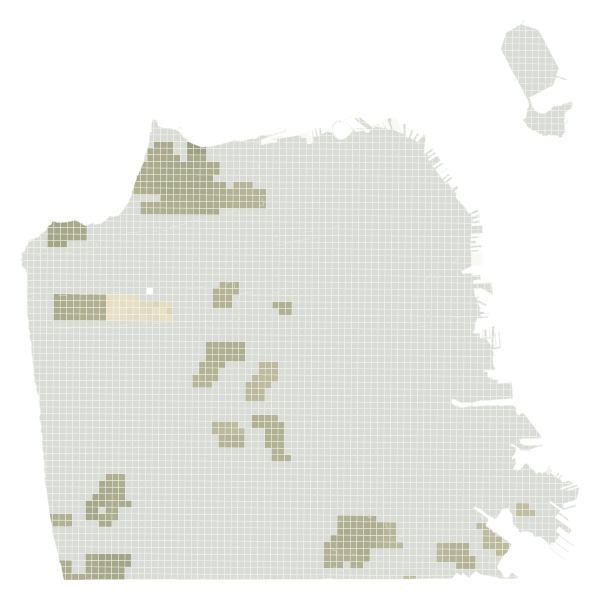
<h2>Soil carbon</h2>
Compare carbon stocks · t C/ha

0≥ 120

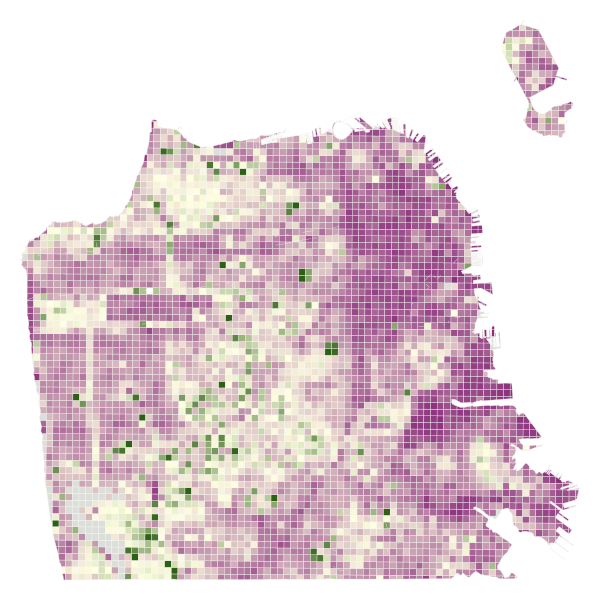<h2>Land degradation</h2>
Productivity performance · NDVI / benchmark

≤ 01≥ 1.5

<!-- Presenter reference: Method adapted from Trends.Earth ↗ (https://docs.trends.earth/en/latest/for_users/features/unccdreporting.html) -->

<!--
“These maps describe different things. Here we zoom into one productivity metric.” Left: scenario land cover, continuous NDVI and soil-carbon density. Right: productivity PERFORMANCE, not combined degradation or full productivity classification. The arrow focuses on the NDVI input; soil carbon is not an input to this ratio. The app groups cells by original dominant land cover and compares their mean annual simulated NDVI with the scene-local 90th percentile in the same group. A ratio of 1 equals that benchmark, not a universal definition of healthy land. The display saturates at 0 and 1.5; missing ratios remain gray. The cover groups simplify the comparable-land units used by Trends.Earth. Performance is one of three productivity submetrics, alongside trajectory and state. Low performance alone does not necessarily classify productivity as declining.
All maps are calculated with the existing application model using the saved SF baseline. They show an illustrative 2046 scenario with 157.905ha of tree-dominant cells converted to built land in 2026, under assumed temperate-dry SOC coefficients. No application scenes were modified. Future NDVI is modeled, not observed. The left NDVI scale saturates at -0.1 and 0.8, and SOC at 120 t C/ha. This slide does not show the combined degradation output; that assessment separately combines land-cover transitions, full productivity classification and SOC change. This is an educational model, not an official SDG assessment or validated forecast. Reproduce using opening_visuals.py; numeric provenance in assets/opening-provenance.json. Method: https://docs.trends.earth/en/latest/for_users/features/unccdreporting.html. 40 seconds.
-->

---

<!-- _class: dark design-divider -->
<h1>Design considerations</h1>

Create an engaging experience for ages 15–24 to explore land-use choices, understand their consequences, and participate in local planning.

<!--
“The science gives us a starting point. The design challenge is making it useful to people.” Introduce four considerations: community agency, existing assessment software, incomplete real data, and defensible response rules. This section explains choices behind the prototype, not proven user impact. 10 seconds.
-->

---

<!-- _class: participation community-design -->
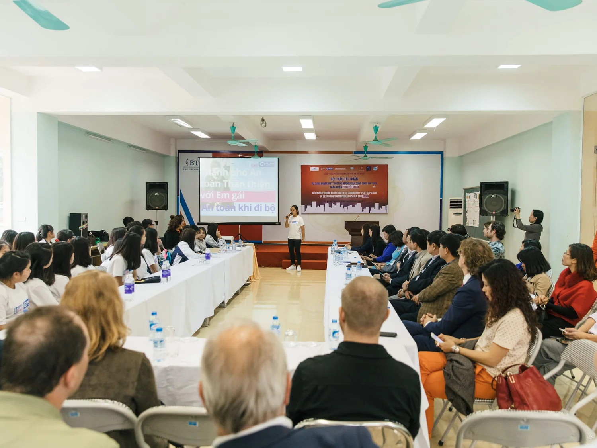

01 / Community involvement
<h1>Block by Block</h1><blockquote>“Minecraft lowers the barrier so that anyone could actually have a say in their public space.”</blockquote>
Lydia Winters · Mojang

<strong>55+</strong> countries
Projects funded or activated by the foundation

People set priorities. Agents help compare.

Young people presenting ideas · Hanoi, Vietnam Photo: Microsoft team / Block by Block

<!--
Sources: https://www.blockbyblock.org/approach (quote, method, photo); https://www.blockbyblock.org/about (foundation-reported reach). “Participation is already possible. Block by Block shows how.” Minecraft is the accessible medium; the workshop is the mechanism. Residents model a public space, discuss priorities and present to decision-makers. This real photograph shows teenage girls presenting ideas to community stakeholders in Hanoi; credit Microsoft team, published on Block by Block's methodology page. The quote is Lydia Winters of Mojang, exact wording. The foundation's About page reports projects funded and activated in more than 55 countries. This is organizational reach, not an independently measured causal impact or a count of countries where our app has users. That same page reports Mojang mobilized over US$5m from its community; omit on-slide to keep the focus on people. The method recommends 30–60 participants over 2–4 workshop days; these are workshop guidelines, not aggregate impact results. Its primary scope is participatory public-space design. The challenge brief identifies ecological consequences and resource constraints as the extension needed; do not claim the program failed at its own purpose. People must feel heard and see their priorities reflected in proposals. In our app, participants can paint and revise directly; agents can help query, compare and explain through the same operations. Automation is assistance, not community consent. We have not tested this in a community workshop. 35 seconds.
-->

---

<!-- _class: design-software -->

02 / Existing software

# Trends.Earth: from data to assessment.

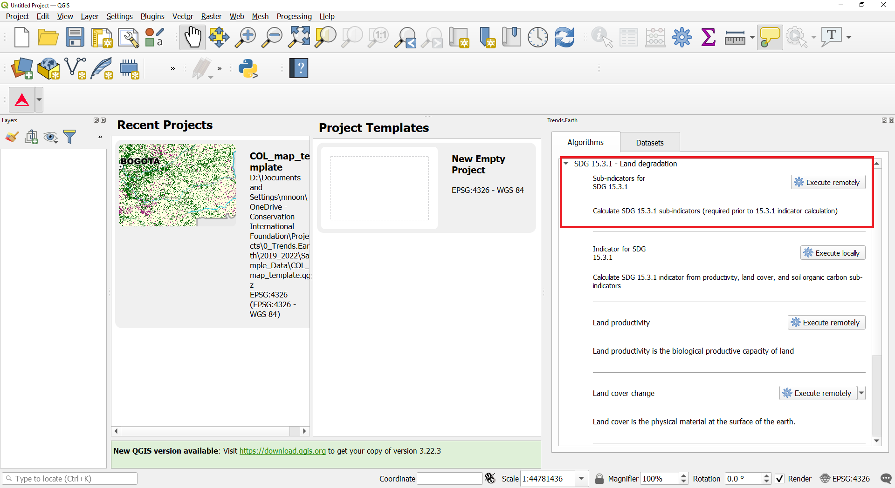

<h2>An expert GIS workflow</h2>
01
Select an area and time period

02
Calculate three land-condition indicators

03
Review maps and area totals

planIt: paint a change → simulate → compare.

<!-- Presenter reference: Screenshot: Trends.Earth documentation ↗ (https://docs.trends.earth/en/latest/for_users/training/landdegradation.html) -->

<!--
“Here is the software we are learning from, and the workflow it supports.” This is an actual screenshot published in the Trends.Earth land-degradation tutorial, not an imitation or an application we ran for the presentation. Source screenshot: https://docs.trends.earth/en/latest/_images/sdg15_highlight_sdg_15_3_1_step1.png; tutorial: https://docs.trends.earth/en/latest/for_users/training/landdegradation.html. The tutorial covers choosing an area and analysis period, computing productivity, cover and carbon sub-indicators, combining assessments, and reviewing spatial and tabular results. The interface shown is the version pictured in the documentation, not a guarantee of the newest installed UI.
Our task is to expose a different interaction: people paint an intervention, see an explicitly modeled response over time and compare alternatives. Trends.Earth's established assessment methods are useful foundations; its tool being technical is a scope distinction, not a failure. Do not claim it has no modeling or scenarios. Our future NDVI response is an additional assumption, not a forecast supplied by Trends.Earth. 30 seconds.
-->

---

<!-- _class: design-data -->

03 / Using real data

# Real data has gaps.

93%

of this SF study area lacks usable soil-carbon values.

<!-- Presenter reference: Saved SF baseline · SoilGrids input -->

<!--
“Here is a limitation the interface has to preserve.” The saved SF baseline has 12,199.422ha total and 836.073ha with valid soil overlap; the area-weighted unavailable fraction is 93.1466%. This describes this snapshot and processing coverage, not all SF soil in every source. Gray is missing data, not zero carbon or evidence of degradation. Land cover, NDVI and SOC have different source resolutions and masks. Aggregation does not create new spatial detail. We retain coverage and avoid extrapolating known carbon values across unknown area. The Muyira case has effectively full coverage, but coverage is not accuracy. Values and sources: assets/provenance.json; https://isric.org/explore/soilgrids. 25 seconds.
-->

---

<!-- _class: design-model -->

04 / Modeling the real world

# Complex modeling

<h2>Trends.Earth · trajectory</h2>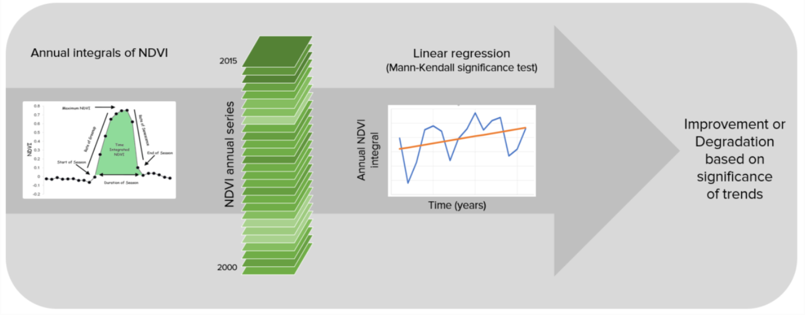

<h2>Trends.Earth · performance</h2>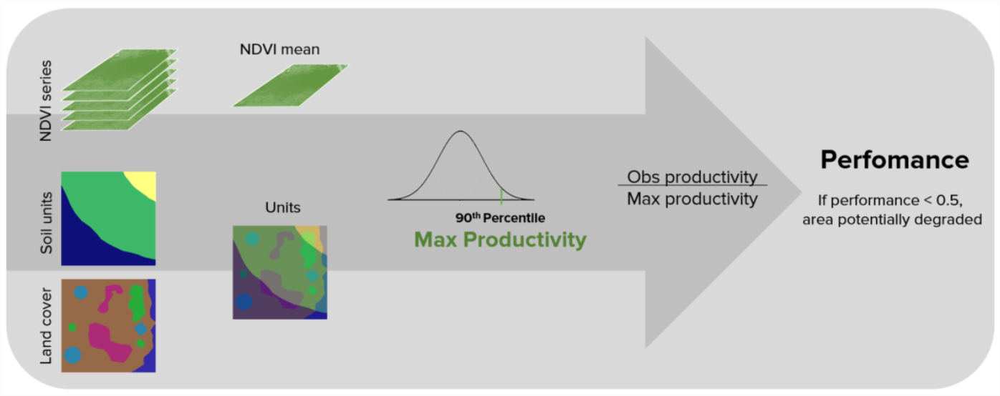

<h2>Satellite measurement</h2>

$$\mathrm{NDVI}=\frac{\mathrm{NIR}-\mathrm{Red}}{\mathrm{NIR}+\mathrm{Red}}$$

Red and near-infrared reflectance

<h2>Our scenario choice</h2>

$$N(t)=N_0+(N_* - N_0)\min\!\left(\frac{t}{\tau},1\right)$$

Tree response: τ = 10 years, assumed

<!-- Presenter reference: Screenshots: Trends.Earth methods ↗ (https://docs.trends.earth/en/latest/for_users/features/unccdreporting.html) -->

<!--
“The assessment itself has several steps. The future response is a separate modeling choice.” The two panels are literal screenshots of figures on the Trends.Earth documentation page, captured without redrawing their contents. Left: annual NDVI integration, regression and a Mann–Kendall significance test. Right: similar-land units from land cover and soil taxonomy, a 90th-percentile benchmark, and the ratio of mean NDVI to that benchmark. These are documentation illustrations, not our site's outputs. Their source dates and examples should not be read as current project data. Source: https://docs.trends.earth/en/latest/for_users/features/unccdreporting.html. Original images: lp_traj_flow.png and lp_perf_flow.png in the documentation's _images directory.
The measurement formula uses near-infrared and red reflectance; reference https://www.usgs.gov/landsat-missions/landsat-normalized-difference-vegetation-index. It does not itself predict the future. On the right, N is simulated NDVI, N0 is its value at the intervention, N* is a cover-dependent target, t is non-negative elapsed years since that edit and tau is the assumed response duration. The displayed formula describes one uninterrupted transition with positive duration; later edits start a new segment. The app clips the target to [-1,1], preserves missing data and handles zero-duration changes separately. For trees tau is 10 years in ndvi-scenario-linear-v0. The target is anchored to the observed starting value plus a cover coefficient adjustment. No regional validation is claimed, and this is not a Trends.Earth forecasting equation. Soil carbon uses a separate 20-year adjustment, discussed in the demo/backup. Our productivity grouping is simplified by original dominant cover, rather than reproducing the documented soil-unit intersection. 45 seconds.
-->

---

<!-- _class: dark demo-divider -->
<!-- _paginate: false -->
# Demo

---

<!-- _class: dark under-divider -->
# Under the hood

Simulation, model assumptions and agent tools.

<!--
“You have seen what it feels like. Here is what is actually underneath it.” Separate real observations from assumed future responses. The implementation is a deterministic Python evaluator behind FastAPI, saved dated actions and immutable baselines, and a map interface. It is not a continuous physical ecosystem simulation. 10 seconds.
-->

---

<!-- _class: after methods-sheet -->

Under the hood / Modeling assumptions

# Modeling assumptions

<h2>Soil carbon</h2>

$$C^*=C_e\sum_k f_{k,e}F_{k\rightarrow j}(\mathrm{climate})$$

$$C(t)=C_e+(C^*-C_e)\,\operatorname{clamp}\!\left(\frac{t-t_e}{20},0,1\right)$$

$$\Delta C=100\left(\frac{C(t)}{C_0}-1\right),\qquad |\Delta C|\geq10\%$$

≤ −10% declining · ≥ +10% improving Top 30 cm · t C/ha · missing or nonpositive C₀: unknown

<h2>Vegetation · our scenario assumption</h2>

$$N^*=\operatorname{clamp}\!\left(N_0+\sum_k\beta_k(f_{k,\mathrm{new}}-f_{k,0}),-1,1\right)$$

$$N(t)=N_e+(N^*-N_e)\,\operatorname{clamp}\!\left(\frac{t-t_e}{\tau_j},0,1\right)$$

τ = 0: replace the surface immediately. Later edits restart from the attained value.

<h3>Carbon conversion F · row → column</h3><table><thead><tr><th></th><th>Tree</th><th>Grass</th><th>Crop</th><th>Wet</th><th>Built</th><th>Bare</th><th>Water</th></tr></thead><tbody><tr><th>Tree / grass</th><td>1</td><td>1</td><td>f</td><td>1</td><td>.1</td><td>.1</td><td>1</td></tr><tr><th>Crop</th><td>1/f</td><td>1/f</td><td>1</td><td>1/.71</td><td>.1</td><td>.1</td><td>1</td></tr><tr><th>Wetland</th><td>1</td><td>1</td><td>.71</td><td>1</td><td>.1</td><td>.1</td><td>1</td></tr><tr><th>Built / bare</th><td>2</td><td>2</td><td>2</td><td>2</td><td>1</td><td>1</td><td>1</td></tr><tr><th>Water</th><td>1</td><td>1</td><td>1</td><td>1</td><td>1</td><td>1</td><td>1</td></tr></tbody></table>
f: temperate dry .80 / moist .69 tropical dry .58 / moist .48 / montane .64

<h3>Vegetation coefficients · β / response years τ</h3><table><thead><tr><th>Tree</th><th>Grass</th><th>Crop</th><th>Wet</th><th>Built</th><th>Bare</th><th>Water</th></tr></thead><tbody><tr><td>.67</td><td>.64</td><td>.55</td><td>.65</td><td>.10</td><td>.10</td><td>−.10</td></tr><tr><td>10 yr</td><td>2 yr</td><td>1 yr</td><td>3 yr</td><td>0 yr</td><td>0 yr</td><td>0 yr</td></tr></tbody></table>
Tree / grass / built β: SF observational fit. Other β: placeholders. All durations: assumptions.

Documented coefficients ≠ locally validated forecasts.

<!-- Presenter reference: Trends.Earth SOC method ↗ (https://docs.trends.earth/en/latest/for_users/features/unccdreporting.html#soil-organic-carbon) · implementation: model.py / ndvi.py -->

<!--
This is the deliberate technical-density slide. Do not read every symbol aloud. “We can expose every coefficient, and separate inherited methods from our own assumptions.” Ce/Ne are attained values at the edit te. C0/N0 are immutable baseline values. f_k,e are previous cover fractions; j is new cover. Climate scalar f in the coefficient table is a different quantity from fractional weights f_k,e. Equal carbon density across mixed cover fractions is assumed. Clamp bounds progress. SOC classification uses signed thresholds, not the absolute value as a direction. Unchanged land has no modeled drift. Source: game-folder/model.py VERSION soc-transition-history-v2, pinned reference https://github.com/ConservationInternational/trends.earth-algorithms/blob/c8b1216c2191c1e209cba2cbb93dc24905dd7f09/te_algorithms/gee/soc.py . NDVI coefficients and response periods copied from game-folder/data/ndvi-scenario-v0.json, ndvi-scenario-linear-v0. The SF fit is observational, not intervention evidence; the carry-forward baseline outperformed its fractional model in the documented holdout. This is not proof of forecast skill. Missing NDVI stays unknown. SOC thresholds are not applied to NDVI. Combined degradation adds cover-transition and simulated-productivity assessments; the source methods slide before Demo already covers those. 35 seconds, or use as a question slide.
-->

---

<!-- _class: after agent-explore -->

The agent / 01 · Explore decisions

# Exploring land-use alternatives

EXAMPLE REQUEST“Try the same area of greening in three different places.”

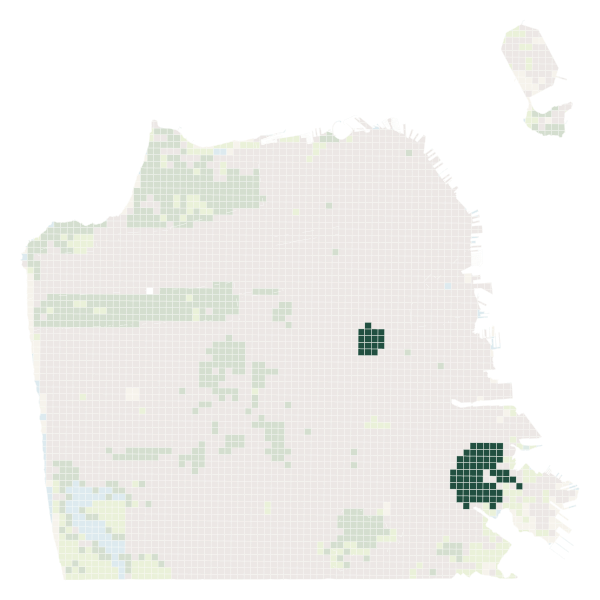<h2>Bayview</h2>

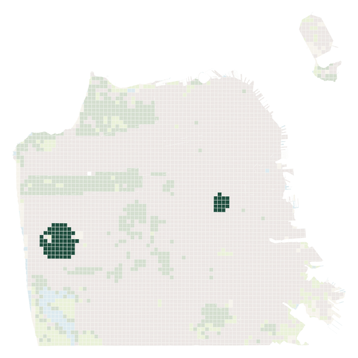<h2>Sunset / Parkside</h2>

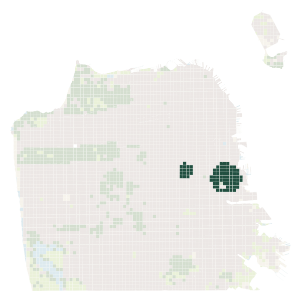<h2>Potrero Hill</h2>

Inspect real cells<i>→</i>Duplicate the starting design<i>→</i>Save dated edits

<strong>80 cells each · 217.8 ha</strong>16 shared Mission cells + 64 alternative cells · whole-cell tree substitutions

<!-- Presenter reference: Saved agent-created alternatives · dark green = selected cells -->

<!--
“Could we try it elsewhere without losing the original?” These three maps come from the saved sf-greening-demo.json agent demonstration. Short prompt is explanatory copy, not a verbatim transcript. Actual workflow: inspect_design → duplicate_design → paint_land_cover. These tools call the same application services as manual interaction; the agent does not invent separate ecological mechanics. Each intervention is dated 2026, evaluated at 2046. Baseline, climate and model versions match. Each design includes 16 common Mission cells and 64 cells in one alternative neighborhood. Full cells are selected with built fraction at least .65 and recorded NDVI/coverage criteria. These are hypothetical whole-cell substitutions, not feasible street-tree plans: site availability, displacement and cost are not modeled. Neighborhood names locate alternatives; they do not establish neighborhood preferences. The person defines constraints and chooses what to keep or revise. Source: game-folder/agent_tools.py, runtime/sf-greening-demo.json and assets/post-demo-provenance.json. 35 seconds.
-->

---

<!-- _class: after agent-compare -->

The agent / 02 · Generate a comparison

# Comparing modeled NDVI

EXAMPLE REQUEST“Compare the three designs at 2046.”

<i class="open-dot"></i>Starting observation<i class="filled-dot"></i>Modeled 2046

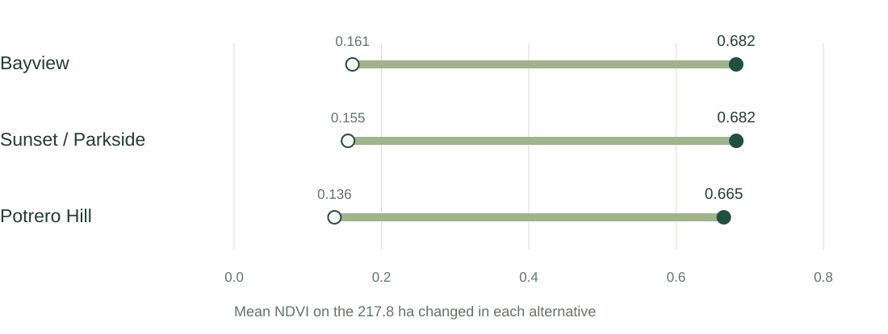
<!-- Presenter reference: Same baseline, year & model settings · selected-area means -->

<!--
“The starting point changes the apparent gain.” Actual selected-area NDVI calculated with the existing ndvi.evaluate_cell implementation, weighted by valid area across each set of 80 cells. All receive the same tree response rule; the baseline-anchored target retains differences. Starting observations are the 2021 baseline, carried forward to the 2026 edit under the unchanged-land assumption. Values: Bayview .16065875→.681557857; Sunset .1546525→.681762896; Potrero .13630375→.664785345. These are NOT the entire-city means and not empirical treatment effects. compare_designs returns whole-scene metrics and between-design spatial fields; this selected-area summary is derived from returned/inspected cell values, rather than claiming the tool returns this exact chart. show_view opens the app comparison and can show mean or variation. The same-scale chart begins at zero; no exaggerated tiny difference. All selected cells have missing SOC in this snapshot, so carbon benefit cannot be assessed there. The gain does not measure cooling, jobs, cost or wellbeing. The user can ask to view different layers and revise the selection; the agent can compare, but no optimum is established. 35 seconds.
-->

---

<!-- _class: after agent-answer -->

The agent / 03 · Ask a measurable question

# “What % of my land is degrading?”

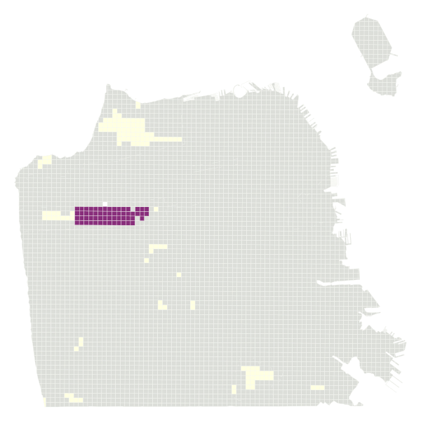SF tree → built scenario · 2046

COMPUTED SCENARIO RESULT

1.3%

of total land is flagged declining

$$\frac{157.9\ \mathrm{ha}}{12{,}199.4\ \mathrm{ha}}\times100$$

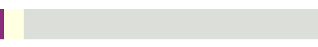
<i style="background:#882e7b"></i>Declining<i style="background:#ffffe1"></i>Stable<i style="background:#dcded9"></i>Unassessed

92.5% remains unassessed. The rest is not automatically healthy.

<!-- Presenter reference: inspect_design → area totals → explicit denominator -->

<!--
Separate example from the greening alternatives: the earlier hypothetical SF conversion of tree-dominant cells to built cover. This uses the actual combined degradation result, not the productivity-performance map shown earlier. Declining157.905ha / total12199.422418ha =1.2943646%. Unknown11284.310409ha =92.4987268%. Stable757.207010ha; improving0. Source assets/opening-provenance.json and post-demo-provenance.json. The map colors represent per-cell dominant/status display; the bar and percentage use fractional area accounting rather than cell counts. It is an example question with a computed answer, not a claimed verbatim agent response or an observed real-world degradation rate. Tool inspect_design provides metrics, coverage, year and assumptions; a response must state the denominator. If asked for the proportion of assessed area, that is a different calculation (~17.3%). Partial declines can be flagged with known evidence while non-declining incompletely covered land remains unassessed. The percentage is affected area, not severity. 35 seconds.
-->

---

<!-- _class: after development-plan -->

Next / Three months of development

# Three-month development plan

<h2>Game mechanics</h2>
Scenario objectivesRestoration, farming and development

Resource constraintsBudgets, land and competing needs

Collaborative planningPropose, discuss and revise together

<h2>Resolution & data</h2>
Finer decision gridsMore detail where source data supports it

Terrain, rainfall and soilAdd inputs beyond the current baseline

Additional hackathon resourcesFAO Earth Map + NatCap Data Hub

<h2>Ecological simulation</h2>
Water and soil movementRunoff, infiltration and erosion

Interactions between cellsUpstream changes, downstream effects

Ecosystem-service modelsIntegrate a relevant InVEST model

<!--
Proposed development priorities over the next three months, not implemented capabilities or a promise of a fully validated ecosystem simulator. Improve the interactive experience through objectives, finite resources and collaborative choices. Use finer or adaptive cells only where the input resolution supports it; a smaller display grid cannot add information to a coarse soil dataset. Terrain and rainfall are candidate additions for physical processes. FAO Earth Map is an exploration/analysis tool, NatCap Data Hub is a catalog, and InVEST is a model suite; these are not three ready-made interchangeable datasets. Choose a specific dataset and one relevant ecosystem-service model, prepare inputs and check local fit. Water routing and erosion can connect upstream interventions with downstream consequences; select one coherent process first. Local parameter review and validation accompany the implementation. These are parallel workstreams, not one column per month. 30 seconds.
-->

---

<!-- _class: after evidence-slide -->

Reference / Keep the evidence inspectable

# Data sources and methods

<h2>Observations</h2>
<a href="https://esa-worldcover.org/en/data-access">ESA WorldCover ↗</a>Land cover · 2021 v200

<a href="https://remotesensing.vito.be/news/simplify-your-processing-worldcover-annual-composites">Sentinel-2 composites ↗</a>Observed vegetation index

<a href="https://isric.org/explore/soilgrids">ISRIC SoilGrids ↗</a>Soil organic carbon · top 30 cm

<h2>Methods & assumptions</h2>
<a href="https://docs.trends.earth/en/latest/for_users/features/unccdreporting.html">Trends.Earth methods ↗</a>Assessment logic & SOC coefficients

model.py · ndvi.pyVersioned scenario implementation

post-demo-provenance.jsonInputs, selected cells, calculated values

<h2>Purpose & participation</h2>
<a href="https://sdgs.un.org/goals/goal15">UN SDG 15 ↗</a>Restoration & land degradation

<a href="https://www.blockbyblock.org/approach">Block by Block ↗</a>Community-led public-space design

Our next evidenceLearning impact remains to be measured

<!-- Presenter reference: © ESA WorldCover project 2021 · modified Copernicus Sentinel data · ISRIC SoilGrids · CC BY 4.0 -->

<!--
Backup slide. Native vector visuals are derived from saved project evidence. All calculations and explanatory example prompts are documented in assets/post-demo-provenance.json. Agent execution records remain local; the presentation includes only aggregate metrics, selected-cell maps and references, not workspace identities, conversation contents or credentials. The deck supports a demonstration of implemented capabilities and explicit assumptions; it does not claim UN endorsement, local validation or demonstrated community impact.
-->
